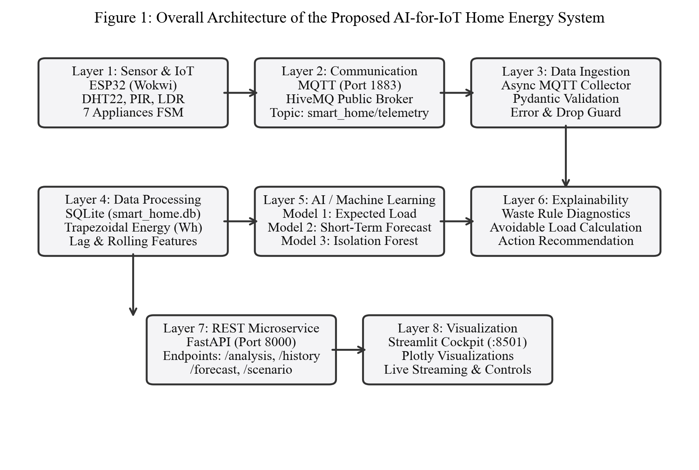
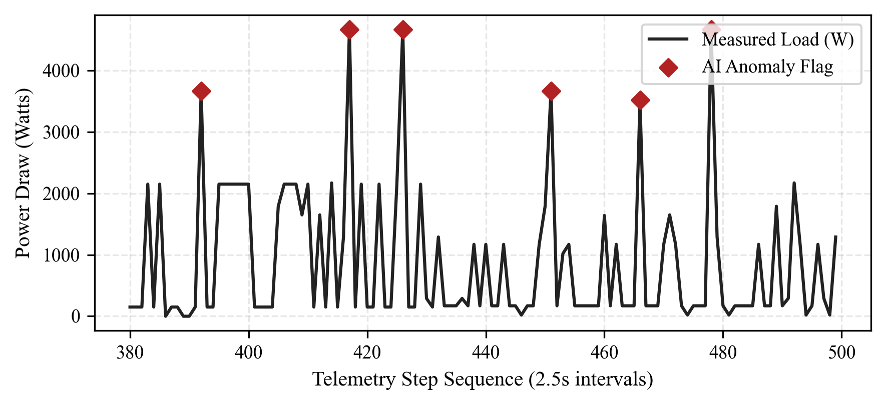
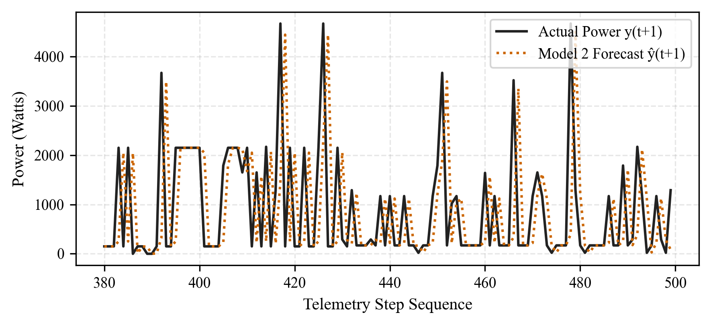
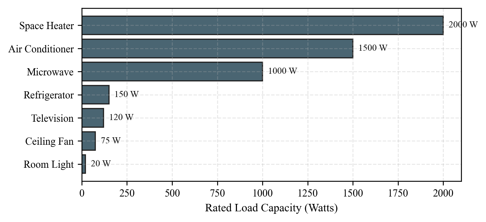
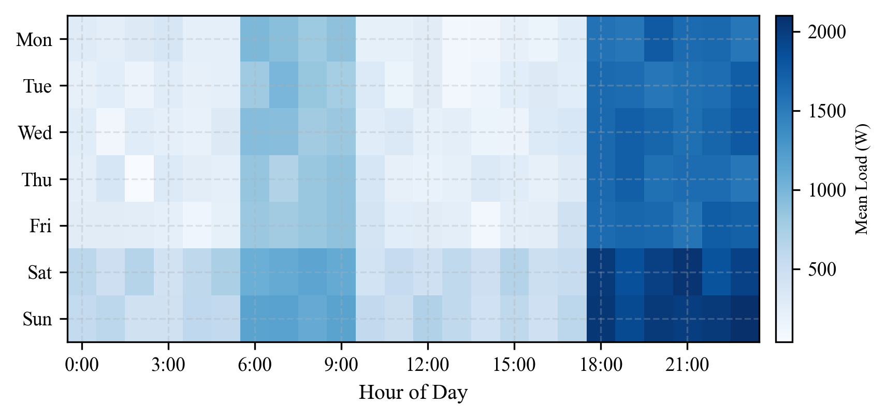
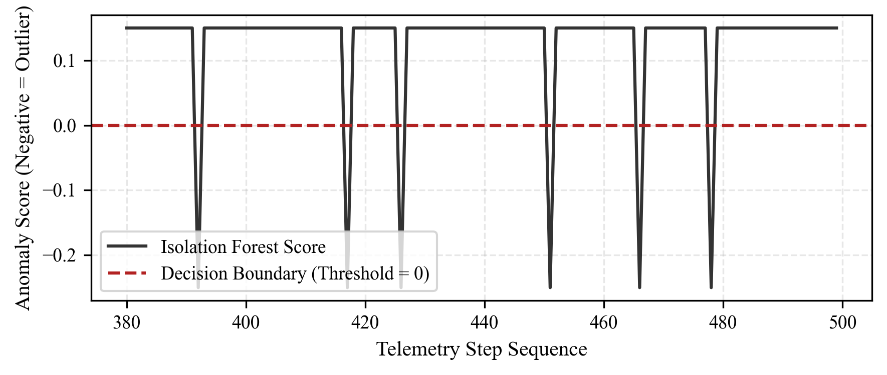
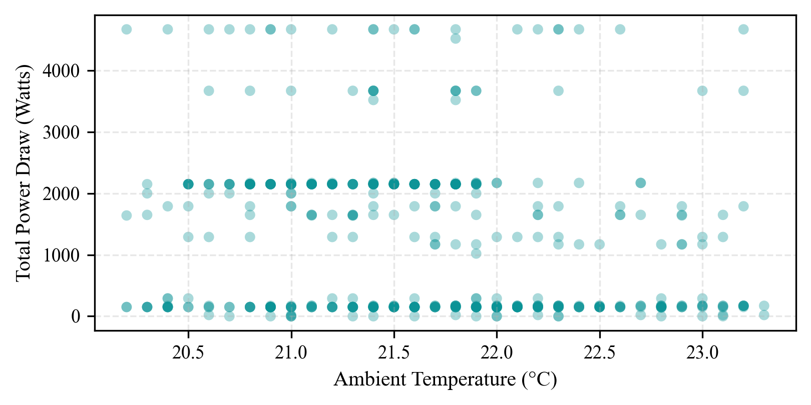

# ⚡ Smart Home Energy Consumption Forecasting & Waste Detection

<div align="center">

[](https://python.org)
[](https://fastapi.tiangolo.com)
[](https://streamlit.io)
[](https://www.hivemq.com)
[](https://wokwi.com)
[](https://scikit-learn.org)
[-2ECC71?style=for-the-badge&logo=githubactions&logoColor=white)]()
[]()

<br />

**An end-to-end cyber-physical IoT and machine learning platform that forecasts short-term residential energy consumption, calculates nominal load decomposition, and diagnoses abnormal or wasteful electrical usage in real-time.**

[Explore Architecture](#-system-architecture) • [Live Dashboard](#-interactive-dashboard) • [Quick Start](#-quick-start-guide) • [ML Models](#-machine-learning-engine) • [API Docs](#-rest-api-reference)

---

</div>

## 📌 System Architecture

```
                  ┌───────────────────────────────────────────────────┐
                  │          VIRTUAL ESP32 SENSOR NODE                │
                  │   DHT22 (Temp/Hum) • PIR (Occupancy) • LDR (Lux)  │
                  │      7 Appliances (Push Buttons + Status LEDs)    │
                  └─────────────────────────┬─────────────────────────┘
                                            │ MQTT Publish (2.5s cadence)
                                            ▼
                  ┌───────────────────────────────────────────────────┐
                  │       PUBLIC MQTT BROKER (HiveMQ Cluster)         │
                  │             Topic: smart_home/telemetry           │
                  └─────────────────────────┬─────────────────────────┘
                                            │ Non-blocking Ingestion
                                            ▼
                  ┌───────────────────────────────────────────────────┐
                  │             FASTAPI ASYNC BACKEND (Port 8000)     │
                  │  Pydantic Validation • SQLite Store • Energy Tally│
                  └─────────────┬───────────────────────┬─────────────┘
                                │                       │
            ┌───────────────────▼────────┐    ┌─────────▼──────────────────┐
            │   MULTI-MODEL ML ENGINE    │    │   EXPLAINABLE RULE ENGINE  │
            │ Model 1: Expected Load OLS │    │  • Vacancy Waste (>1kW)    │
            │ Model 2: 2.5s AR Forecast  │    │  • Daylight Lighting Waste │
            │ Model 3: Isolation Forest  │    │  • HVAC Conflict / Overload│
            └───────────────────┬────────┘    └─────────┬──────────────────┘
                                │                       │
                                └───────────┬───────────┘
                                            │ Unified Analytics JSON
                                            ▼
                  ┌───────────────────────────────────────────────────┐
                  │    STREAMLIT LIQUID GLASS DASHBOARD (Port 8501)   │
                  │    10 Plotly Charts • Real-Time Stream • Scenarios│
                  └───────────────────────────────────────────────────┘
```

<div align="center">
  
</div>

---

## ✨ Key Features

- **Cyber-Physical Edge Emulation:** Virtual ESP32 runs Arduino C++ in Wokwi, driving environmental sensors (`DHT22`, `PIR`, `LDR`), 7 appliance controls with software debouncing, 7 status LEDs, and an `SSD1306` 128x64 OLED display.
- **Asynchronous Telemetry:** Streams deterministic load telemetry frames every 2.5 seconds over MQTT to HiveMQ broker.
- **Zero-Leakage Multi-Model Machine Learning:**
  - **Model 1 (Expected Load):** Ordinary Least Squares Linear Regression recovering exact rated physical load coefficients ($R^2 = 1.000$, MAE $= 0.00\text{ W}$).
  - **Model 2 (Short-Term Power Forecasting):** Autoregressive lagged linear model predicting power for the immediate next 2.5-second interval ($t+1$) without lookahead target leakage ($R^2 = 0.2142$, MAE $= 830.11\text{ W}$).
  - **Model 3 (Unsupervised Anomaly Detection):** Multivariate Scikit-Learn `IsolationForest` detecting severe concurrent overloads ($>4,500\text{ W}$) and irregular sensor combinations.
- **Explainable Rule-Based Waste Detection:** Quantifies **Avoidable Load (Watts)** with plain-English corrective instructions for unattended appliances, daytime lighting, and opposing HVAC cycles.
- **Apple-Inspired Interactive Cockpit:** High-density Streamlit dashboard with 10 interactive Plotly visualizations, dark/light glassmorphic modes, appliance ribbon, point investigation, and preset simulation scenarios.

---

## 📊 Visual Analytics & Intelligence Gallery

<div align="center">

| Real-Time Power & Anomaly Timeline | Multi-Model AI Load Comparison |
| :---: | :---: |
|  |  |

| Appliance Load Contribution Breakdown | 24x7 Diurnal Load Density Heatmap |
| :---: | :---: |
|  |  |

| Isolation Forest Anomaly Scoring Curve | Thermodynamic Response Correlation |
| :---: | :---: |
|  |  |

</div>

---

## 🔌 Simulated Appliance Inventory

| Appliance | Key | Category | Rated Load (W) | Operational Characteristics |
| :--- | :---: | :---: | :---: | :--- |
| **Air Conditioner** | `ac` | HVAC | **1,500 W** | High-draw seasonal thermal cooling |
| **Space Heater** | `heater` | HVAC | **2,000 W** | High-draw resistive heating |
| **Microwave Oven** | `microwave` | Kitchen | **1,000 W** | High-draw intermittent meal preparation |
| **Refrigerator** | `refrigerator` | Kitchen | **150 W** | Continuous baseline cycling compressor |
| **Television** | `tv` | Entertainment | **120 W** | Discretionary entertainment load |
| **Ceiling Fan** | `fan` | Circulation | **75 W** | Continuous low-power circulation |
| **Room Light** | `room_light` | Lighting | **20 W** | Ambient illuminance |

$$\text{Instantaneous Power } (W) = \sum_{k=1}^{7} \text{Rated Watts}_k \times \text{State}_k$$

---

## 🧠 Machine Learning Engine Summary

| Model | Target & Task | Architecture | Key Features | Verified Metric |
| :--- | :--- | :--- | :--- | :--- |
| **Model 1** | Nominal Expected Load ($P_{\text{exp}}$) | OLS Linear Regression | 21 features (Appliances, Sensor states, Interaction terms) | **MAE: 0.00 W, $R^2$: 1.000** |
| **Model 2** | Next-Step Power Forecast ($P_{t+1}$, 2.5s horizon) | Lagged Autoregression | 10 features ($P_{t-1}, P_{t-2}, P_{t-3}$, Rolling Mean, $\Delta P$, Temp, Hum, Occ) | **MAE: 830.11 W, $R^2$: 0.2142** |
| **Model 3** | Severe Anomaly & Spike Detection | Isolation Forest | 8 multivariate features, 5% contamination | **360 Outliers Flagged / 7,200** |

---

## 🚀 Quick Start Guide

### 1. Clone & Install Dependencies

```bash
git clone https://github.com/SaMomin0/smart-home-energy-forecasting.git
cd smart-home-energy-forecasting

# Optional: Virtual environment
python3 -m venv venv
source venv/bin/activate  # On Windows: venv\Scripts\activate

# Install requirements
pip install -r requirements.txt
```

---

### 2. Launch the System

#### Option A: One-Click Launch in VS Code
Open this folder in VS Code, go to the **Run & Debug** tab (`Cmd+Shift+D` or `Ctrl+Shift+D`), select:
- **`Launch Complete System (Backend + Dashboard)`** $\rightarrow$ Click **Play (▶)**.

#### Option B: Launch via Terminals

```bash
# Terminal 1: FastAPI Backend (Port 8000)
python3 -m uvicorn backend.api:app --host 0.0.0.0 --port 8000 --reload

# Terminal 2: Streamlit Dashboard (Port 8501)
PYTHONPATH="$PWD" python3 -m streamlit run dashboard/app.py --server.port 8501
```

- **Dashboard:** [http://localhost:8501](http://localhost:8501)
- **FastAPI Swagger Docs:** [http://localhost:8000/docs](http://localhost:8000/docs)

---

### 3. Run the Wokwi ESP32 IoT Simulation

You can feed live telemetry into the system in three ways:

1. **Instant Wokwi Web (Zero local toolchain setup):**
   - Open [wokwi.com/projects/new/esp32](https://wokwi.com/projects/new/esp32)
   - Copy-paste `sketch.ino`, `diagram.json`, and `libraries.txt`.
   - Click **Start Simulation**. The ESP32 connects to HiveMQ and your local dashboard updates live every 2.5s!
2. **Interactive Terminal Simulator (Included in repo):**
   ```bash
   python3 simulate_esp32_mqtt.py
   ```
   Press `1` (AC), `2` (Fan), `6` (Heater), `o` (Occupancy) to toggle appliances in real-time.
3. **Wokwi VS Code Extension:**
   - Compile using PlatformIO (`pio run`) with the included `platformio.ini`.
   - Press `Cmd+Shift+P` $\rightarrow$ **Wokwi: Start Simulator**.

---

## 🌐 REST API Reference

| Endpoint | Method | Response Description |
| :--- | :---: | :--- |
| `/health` | `GET` | Service status, MQTT broker health, loaded model checklist |
| `/latest` | `GET` | Most recent parsed telemetry frame from MQTT cache |
| `/history` | `GET` | Historical records from SQLite (query parameter `limit=500`) |
| `/prediction` | `GET` | Model 1 expected load calculation and decomposition error |
| `/forecast` | `GET` | Model 2 short-term power prediction for the next 2.5s step |
| `/anomaly` | `GET` | Model 3 Isolation Forest outlier detection, anomaly flag, and score |
| `/waste` | `GET` | Rule-based waste evaluation, avoidable watts, and rationale |
| `/recommendation`| `GET` | Actionable prescriptive advisories for user action |
| `/analysis` | `GET` | Consolidated payload consumed by the dashboard in a single roundtrip |
| `/export/csv` | `GET` | Complete database telemetry export as CSV |
| `/scenario` | `POST` | Inject controlled evaluation presets (`NORMAL`, `WASTEFUL`, `HIGH LOAD`, `SPIKE`) |

---

## 🧪 Automated Testing

The project includes an exhaustive unit and integration test suite:

```bash
python3 -m unittest discover tests
```

```text
Ran 68 tests in 4.87s

OK (68/68 PASS, 100%)
```

- **MQTT & Data Schemas (11 tests):** Verifies Pydantic strict validation, float rounding, payload corruptions.
- **SQLite Engine (6 tests):** Verifies cumulative kilowatt-hour Riemann integration and historical retrieval.
- **ML Models (13 tests):** Validates Linear Regression ($R^2=1.0$), autoregressive forecasting, and anomaly detection.
- **Domain Waste Rules (5 tests):** Validates vacancy waste, daytime lighting, and operational conflict.
- **FastAPI REST Endpoints (12 tests):** Tests all 11 endpoints with HTTP status codes and responses.
- **Dashboard & Plotly Visualizations (21 tests):** Verifies layout rendering, session states, and chart pipelines.

---

## 📂 Project Structure

```text
.
├── backend/                  # FastAPI asynchronous microservice
│   ├── api.py               # REST route handlers (11 endpoints)
│   ├── collector.py         # MQTT subscriber daemon & cache
│   ├── database.py          # SQLite schema & session management
│   ├── predictor.py         # Model 1: Expected Load Linear Regression
│   ├── forecaster.py        # Model 2: Short-Term Power Forecaster
│   ├── anomaly.py           # Model 3: Isolation Forest Outlier Detector
│   ├── rules.py             # Domain rule engine (Avoidable Load)
│   ├── recommendations.py   # Prescriptive advice generator
│   └── schemas.py           # Pydantic telemetry & API models
├── dashboard/                # Streamlit interactive liquid-glass cockpit
│   ├── app.py               # Main UI entrypoint & auto-refresh lifecycle
│   ├── api_client.py        # HTTP client connecting to FastAPI
│   ├── components/          # Reusable UI widgets & Plotly charts
│   └── styles/              # Dark/light theme & glassmorphic CSS tokens
├── data/                    # Storage layer
│   ├── energy_data.csv      # 7,200-sample historical training dataset
│   └── smart_home.db        # Live SQLite persistent database
├── docs/                    # Technical documentation & figures
│   ├── figures/             # High-res architecture & analytics figures
│   ├── ARCHITECTURE.md      # Detailed 9-layer system specification
│   ├── API.md               # API contract and payload examples
│   └── ML_REPORT.md         # Machine learning methodology & evaluation
├── models/                  # Serialized trained scikit-learn models (.joblib)
├── scripts/                 # Data synthesis, model training & reporting
├── tests/                   # 68 automated unit & integration tests
├── diagram.json             # Wokwi ESP32 circuit layout & wiring
├── sketch.ino               # ESP32 C++ firmware with WiFi, MQTT, Sensors & OLED
├── libraries.txt            # Arduino dependencies for Wokwi
├── platformio.ini           # PlatformIO configuration for local compilation
├── simulate_esp32_mqtt.py   # Interactive keyboard-controlled virtual ESP32
├── requirements.txt         # Pinned Python package dependencies
└── README.md                # Project documentation
```

---

## 📄 License

This project is licensed under the MIT License — see the [LICENSE](LICENSE) file for details.
