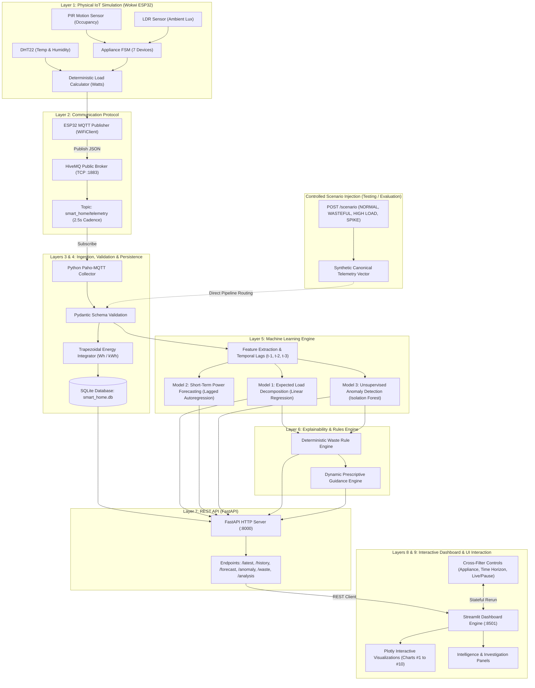

# System Architecture & Technical Specification

**Project Title:** AI-Based Smart Home Energy Consumption Forecasting & Wasteful Usage Detection  
**Document:** System Architecture (Layers 1–9)  
**Author:** AI-for-IoT Capstone Team  
**Status:** Certified Release Candidate (Phase 3.4)

---

## 1. Architectural Overview

The system is designed as an end-to-end, multi-layered cyber-physical AI-IoT platform. It captures environmental signals and appliance activities from a simulated smart home, streams structured telemetry through an asynchronous MQTT broker, executes machine learning inference and rule-based diagnostics in Python, and presents actionable intelligence through an Apple-inspired interactive dashboard.

---

## 2. Layer-by-Layer Detailed Breakdown

### Layer 1: IoT Hardware Simulation
* **Platform:** Wokwi Virtual ESP32 Simulator (`sketch.ino`, `diagram.json`, `wokwi.toml`).
* **Microcontroller:** ESP32 Dual-Core Tensilica LX6 running at 240 MHz.
* **Environmental Sensors:**
  * **DHT22 (AM2302):** Temperature range $-40^\circ\text{C}$ to $+80^\circ\text{C}$ ($\pm 0.5^\circ\text{C}$), Relative Humidity $0\%$ to $100\%$ ($\pm 2\%$).
  * **PIR Motion Sensor (HC-SR501):** Binary room occupancy detection ($0 = \text{Vacant}$, $1 = \text{Occupied}$).
  * **LDR Photoresistor Module:** Analog ambient illuminance converted to Lux ($0$ to $1000\text{ lx}$).
* **Virtual Household Appliances (7 Devices):**
  * Air Conditioner: $1,500\text{ W}$ (HVAC)
  * Space Heater: $2,000\text{ W}$ (HVAC)
  * Microwave Oven: $1,000\text{ W}$ (Kitchen)
  * Refrigerator: $150\text{ W}$ (Kitchen, cyclical compressor baseline)
  * Television: $120\text{ W}$ (Entertainment)
  * Ceiling Fan: $75\text{ W}$ (Circulation)
  * Room Light: $20\text{ W}$ (Lighting)
* **Sampling Cadence:** Real-time periodic broadcast every $2,500\text{ ms}$ ($2.5\text{ seconds}$).

### Layer 2: Network Communication
* **Transport:** TCP/IP over virtual WiFi (`Wokwi-GUEST`).
* **Messaging Protocol:** MQTT v3.1.1.
* **Broker:** Public HiveMQ Cluster (`broker.hivemq.com` on port `1883`).
* **Topic Architecture:**
  * `smart_home/telemetry`: High-frequency sensor and appliance payload stream.
  * `smart_home/control`: Bidirectional remote actuator simulation channel.
* **Payload Structure:** Lightweight serialized JSON with uptime, environmental signals, binary device states, total power, and diagnostic flags.

### Layer 3: Telemetry Ingestion
* **Service:** Dedicated background daemon using `paho-mqtt` (`backend/collector.py`).
* **Connection Resilience:** Automatic exponential backoff reconnection, thread-safe message queues, clean disconnection handling.

### Layer 4: Data Processing & Persistence
* **Schema Validation:** Strict type enforcement and bounds checking via Pydantic v2 (`backend/schemas.py`).
* **Energy Integration:** Continuous numerical trapezoidal integration converting instantaneous power ($W$) into cumulative energy ($Wh$ and $kWh$):
  $$\Delta E = P_t \times \frac{\Delta t}{3600}, \quad E_{\text{total}} = \sum \Delta E$$
  For nominal intervals ($\Delta t = 2.5\text{s}$), $\Delta E = P \times 0.0006944\text{ Wh}$.
* **Storage Engine:** SQLite relational database (`data/smart_home.db`) indexed chronologically on ISO-8601 UTC timestamps.

### Layer 5: Machine Learning Engine
* **Model 1 — Expected Appliance Load Decomposition:**
  * **Algorithm:** Ordinary Least Squares Linear Regression (`backend/predictor.py`).
  * **Input Features:** 21 environmental and appliance state variables.
  * **Role:** Baseline power reconstruction ($R^2 = 1.000$, $\text{MAE} = 0.0\text{ W}$).
* **Model 2 — Short-Term Power Forecasting:**
  * **Algorithm:** Lagged Autoregressive Linear Regression (`backend/forecaster.py`).
  * **Input Features:** Lagged power observations ($t-1, t-2, t-3$), 3-step rolling mean, gradient trend, temperature, humidity, occupancy, hour, minute.
  * **Target Horizon:** Next telemetry interval ($t+1$, 2.5 seconds ahead).
  * **Strict Data Leakage Prevention:** Contemporaneous power ($P_t$), future power, and active appliance states are strictly excluded from the feature set.
  * **Metrics:** $\text{MAE} = 830.11\text{ W}$, $\text{RMSE} = 1070.58\text{ W}$, $R^2 = 0.2142$.
* **Model 3 — Unsupervised Anomaly Detection:**
  * **Algorithm:** `IsolationForest` (100 estimators, $5\%$ contamination).
  * **Role:** Isolates statistical outliers, excessive multi-device concurrent draw, and unexpected power spikes.

### Layer 6: Explainability & Rules Engine
* **Deterministic Rules:**
  1. *Vacancy Waste:* High-draw appliances ($>1000\text{ W}$), television, or room light operating when `occupancy == 0`.
  2. *Daylight Waste:* Room light active when ambient illuminance exceeds $300\text{ Lux}$.
  3. *Operational Conflict:* Air Conditioner and Space Heater active simultaneously.
  4. *High Load Warning:* Household load exceeding grid threshold ($>3,000\text{ W}$ Warning, $>4,500\text{ W}$ Critical).
* **Prescriptive Recommendations:** Dynamic generation of specific, actionable mitigation steps with estimated load reduction impact in Watts.

### Layer 7: Application Programming Interface (API)
* **Framework:** FastAPI with Uvicorn ASGI server (`backend/api.py`).
* **Endpoints:** Comprehensive RESTful interface serving live analysis, historical telemetry, model metadata, database CSV export, and scenario injection.
* **Controlled Scenario Endpoint (`POST /scenario`):** Allows evaluators to inject canonical testing vectors (`NORMAL`, `WASTEFUL`, `HIGH LOAD`, `SPIKE`) through the genuine AI and rule pipeline for deterministic evaluation.

### Layer 8: Visualization Engine
* **Framework:** Streamlit (`dashboard/app.py`).
* **Design System:** Apple Liquid Glass aesthetic featuring translucent cards, curated typography, subtle borders, and smooth responsiveness across Light and Dark themes.
* **Charts:** 10 interactive Plotly visualizations covering time-series power streams, load decomposition, correlation heatmaps, Sankey power flows, and additive waterfall load breakdowns.

### Layer 9: User Interaction System
* **Centralized Interaction State:** Global session state synchronizing appliance filters, point selection, anomaly deep-dive drawers, time-horizon scoping, and streaming control (Live / Pause).
* **Honest Interaction Principle:** Appliance-level historical power is explicitly labeled as *Estimated Appliance Load* (derived mathematically), and recommendation actions are strictly labeled as *Suggested Actions* rather than claiming physical hardware actuation.
